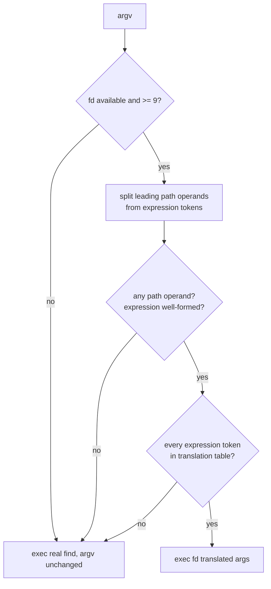

# SPEC: `find` wrapper — fd-accelerated find shim

Status: v1.1 (revised after empirical review; every translation row below was
verified against the reference binaries)
Reference implementations: GNU findutils 4.11 (`/usr/bin/find`), fd 10.5
(`/usr/bin/fd`). All behavior claims in this document were tested against
these, not against `--help` text.

## 1. Problem

AI agents (and humans on autopilot) habitually invoke `find` for filesystem
queries. On large trees `find` is slow: single-threaded, no ignore-file
support. `fd` is a faster, parallel, ignore-aware replacement — but its CLI
differs (`fd [pattern] [path]…` vs `find path… [expression]`), so callers
can't just swap binaries.

## 2. Solution

A shim executable named `find` that:

1. Parses the incoming find-style argv.
2. If the whole invocation maps onto fd flags → `exec fd <translated args>`.
3. Otherwise → `exec <real-find> <original argv, untouched>`.
4. If fd is not installed → always step 3.

The shim must actually be reached by the caller. A PATH entry alone is not
sufficient in all environments — see §6 Deployment, which is a mandatory
part of this spec, not an afterthought.

## 3. Goals / non-goals

**Goals**

- Drop-in for the read-only queries that dominate agent usage:
  name/type/mtime/depth/owner searches over one or more roots.
- All-or-nothing translation: an invocation is either fully translated or
  passed to real find verbatim. Never a partial translation.
- Fallback preserves exact argv, exit code, and stderr of real find.
- Zero dependencies beyond `fd`, the system `find`, and **bash** (arrays are
  required for safe argv construction; POSIX sh is not sufficient).
- Shim startup overhead ~10 ms (measured 10–11 ms; dominated by the fd
  version-check fork — correctness over microseconds).

**Non-goals**

- Full find expression language (OR, NOT, parens, `-prune`, `-delete`,
  `-exec`, `-printf`). These fall back in v1.
- Byte-identical output (see §4.6 divergences: directory trailing slashes,
  root inclusion, ordering).
- Speeding up destructive operations. `-delete` intentionally always falls
  back: accelerating deletions through a translation layer is risk with no
  upside.

## 4. Architecture

### 4.1 Locating the real find

Resolution order, first hit wins:

1. `$FIND_WRAP_REAL_FIND` if set and executable.
2. `/usr/bin/find`, `/bin/find` (fixed paths, in order).
3. First `find` in `PATH` that is not the shim itself.

Self-detection compares device+inode (`[[ candidate -ef $0 ]]`), which
catches symlinks and hardlinks to the shim; a path-string compare would
miss hardlinks. Empty PATH elements are treated as `.` per PATH semantics.

If none found: error to stderr, exit 127. The shim must never exec itself.

### 4.2 Locating fd

Resolution order, first hit wins:

1. `$FIND_WRAP_FD` if set and executable.
2. `/usr/bin/fd`, `/usr/bin/fdfind` (fixed paths).
3. `fd`, then `fdfind` from `PATH`.

Rationale for absolute paths before PATH: some agent harnesses (omp
verified) provide an **in-process `fd` builtin ahead of PATH** whose
behavior diverges from the real binary (observed: builtin fd 10.4.2 rejects
`fd -o <username>` with "require numeric uid/gid"; real fd 10.5.0 accepts).
The shim must bind to a known real binary.

Sanity check on every invocation: `fd --version` must parse and be ≥ 9.
On failure → treat fd as absent (fall back). Cost is one fork.

If no fd found → all invocations fall back.

### 4.3 Dispatch flow

### 4.4 Argument splitting

find grammar: `find [-H|-L|-P] [-D debug] [-O level] path… [expression]`.

- Consume global options: `-H`/`-L`/`-P` are mutually exclusive, last one
  wins. `-L` → fd `-L`; `-H` → no fd flag (fd's default of following
  command-line dir symlinks matches find `-H`); `-P` → no fd flag. `-D*`,
  `-O*` → fallback.
- Consume path operands until the first token starting with `-`, or equal
  to `!`, `(`, `)`.
- **Zero path operands → fallback.** GNU find with no path searches `.`
  (verified: it does not error); only real find may reproduce that default
  and any diagnostics exactly.
- **Symlink search roots → fallback**, unless `-H`/`-L` was given AND the
  root resolves to a directory. Verified: with default `-P`, find prints a
  dir-symlink root without descending while fd descends it; and fd errors
  ("not a directory", rc=1) on file-symlink roots where find prints them.
- **Any malformed expression → fallback.** Includes: predicate missing its
  argument (`find . -name`), a non-numeric or out-of-range
  `-maxdepth`/`-mmin` argument, empty/invalid `-user`/`-group` names, and
  anything the parser doesn't recognize. Fallback makes real find produce
  the exact error message and exit code; the shim never invents its own
  diagnostics.
- Remaining tokens are the expression.

### 4.5 Translation table (verified rows only)

Any token not listed, or any use of `-o`, `-a`, `!`, `-not`, `(`, `)`,
`-prune`, `-delete`, `-exec*`, `-ok*`, `-quit`, `-fprintf`, `-fls`, `-fprint`
→ **fallback the entire invocation**.

| find | fd | Verification / notes |
|---|---|---|
| *(no expression)* | *(empty positional pattern)* | `fd --hidden --no-ignore '' .` reproduced GNU find's full listing incl. `.git` |
| `-name GLOB` | `-g GLOB -s` | `-s` is mandatory: fd smart-case applies to globs (`fd -g readme` matches `README`; find doesn't). `-g` is mandatory: fd's positional pattern is a **regex** — `fd '*.txt'` fails with a regex parse error. GLOB must be non-empty, contain no `/` (find matches basenames only), and not start with `-` (fd's option parser would eat it) — otherwise fallback |
| `-iname GLOB` | `-g GLOB -i` | same guards |
| `-type f\|d\|l` | `-t f\|d\|l` | other type letters → fallback; **repeated `-type` → fallback** (find ANDs, fd ORs) |
| `-empty` | `-t e` | |
| `-maxdepth N` | `-d N` | N numeric, ≤ 9 digits, once; N=0 divergence: see §4.6 |
| `-mindepth N` | `--min-depth N` | N numeric, ≤ 9 digits, once |
| `-mtime -N` | `--changed-within Nd` | verified: duration syntax `1d` accepted; N ≥ 1 (N=0 inverts meaning under fd's windows); **at most one `-mtime`/`-mmin` total** (find ANDs repeats, fd is last-wins) |
| `-mtime +N` | `--changed-before Nd` | same guards |
| `-mtime N` (exact) | fallback | fd windows are one-sided |
| `-mmin -N` / `+N` | `--changed-within Nm` / `--changed-before Nm` | same guards |
| `-user U` | `-o U` | verified on real fd 10.5; broken on omp's builtin fd — see §4.2; once; U must be non-empty, no `:`, not `-`-leading (find errors on those; `fd -o ''` would silently list everything). Residual: a valid-shaped but nonexistent user errors either way (fd rc=2 vs find rc=1) — diagnostics differ, both fail |
| `-group G` | `-o :G` | same guards |
| `-print0` | `-0` | at most one `-print`/`-print0` total (find duplicates output on repeats, fd dedups) |
| `-print` | *(drop)* | fd default; same repeat guard |
| `-executable` | **fallback** | find matches executable files AND searchable dirs; fd `-t x` implies files only and cannot express the dir half — silent incomplete results |
| `-size`, `-newer`, `-newermt`, `-path`, `-ipath`, `-regex`, `-iregex`, `-perm`, `-links`, `-inum`, `-samefile`, `-xdev`, `-mount`, `-depth`, `-ls` | **fallback** | see below |

Rows demoted to fallback, with evidence:

- **`-size`**: doubly incompatible. GNU find rounds up to units
  (`find -size 100k` matches a 102,399-byte file) while fd is exact;
  fd's `k` is 1000 (SI, `KiB` = 1024) while find's `k` is 1024; fd rejects
  bare byte counts (`-S 102400` → "not a valid size constraint") and the
  `c` suffix. Only `+`/`-` forms with `k/M/G`→`KiB/MiB/GiB` mapping would
  be safe — v2 candidate; v1 falls back.
- **`-path`/`-ipath`**: find's `-path` globs let `*` cross `/`; fd globs
  don't. Patterns as typed by the caller include the `./` root prefix,
  which fd strips; `fd -p -g './src/*'` errors out ("pattern only matches
  files with a leading dot…") and `fd -p -g 'src/*'` matches nothing where
  find matches. Not a flag swap — v1 falls back.
- **`-regex`/`-iregex`**: dialect change (Emacs vs Rust regex) is exactly
  the silent semantic drift this spec's all-or-nothing rule exists to
  prevent. v1 falls back.
- **Multiple name predicates** (`-name a -name b`): `--and` interaction
  with `-g`/`-s` is unverified. v1: more than one `-name`/`-iname` in the
  expression → fallback.

Pattern selection for the fd invocation:

- The (single, if present) `-name`/`-iname` glob is passed via `-g` with
  the matching case flag. The positional pattern slot is used **only** for
  the empty match-all pattern `''`; paths follow it positionally.

### 4.6 Semantic parity flags and accepted divergences

The shim **always** injects (verified necessary: without them fd omits
`.git`, `.hidden/`, and gitignored files that find shows):

| Flag | Why |
|---|---|
| `--hidden` | find descends into dotfiles/dirs; fd skips them by default |
| `--no-ignore` | find ignores no ignore-files; fd respects .gitignore/.ignore |
| `--color=never` | find output is never colored, even on TTY |

Optional fast mode, opt-in via `FIND_WRAP_MODE=fast`: omit `--hidden
--no-ignore` (fd defaults). Documented divergence, never the default.

Accepted, documented divergences:

- **Directory trailing slash**: fd prints directories with a trailing `/`
  (`./src/`); find prints `./src`. The shim does **not** post-process
  (that would break the zero-copy `exec` model). Consumers doing exact
  string comparison on directory names must strip. Parity tests compare
  with trailing slashes normalized.
- **Root inclusion**: find prints the search root itself; fd never does.
  This includes `-maxdepth 0` (find prints the root; `fd -d 0` prints
  nothing, rc=0).
- **Output order**: fd traverses in parallel; order differs from find's
  DFS. Neither tool guarantees order.
- **Exit status**: both return 0 on "no matches" (verified); fd errors
  (rc=2) only on real errors, same class as find. Compatible.

## 5. Environment / escape hatches

| Var | Effect |
|---|---|
| `FIND_WRAP_OFF=1` | pure passthrough to real find |
| `FIND_WRAP_MODE=compatible\|fast` | see §4.6; default `compatible` |
| `FIND_WRAP_FD=/path` | fd binary override |
| `FIND_WRAP_REAL_FIND=/path` | real find override |
| `FIND_WRAP_DEBUG=1` | log translation (`find … → fd …` or fallback reason) to stderr |

## 6. Deployment (mandatory)

A PATH shim only works where PATH resolution is actually used. Verified
counterexample: **omp's bash tool resolves `find` and `fd` as in-process
builtins ahead of PATH** (`type find` → "shell builtin"; builtin
`find --version` → 0.8.0 while `/usr/bin/find` is GNU 4.11.0). In such
shells a `~/.local/bin/find` shim is never executed.

Investigated switches (omp source v18.8.7 at
`thirdparty/oh-my-pi`, running build 19.1.1; cfg:// dump of the running
build has no builtin toggle):

- **`PI_DISABLE_UUTILS_BUILTINS=1`** (process env or shell config env;
  `crates/pi-shell/src/shell.rs` gate) removes the whole in-process
  utility set — cat, ls, grep, jq, fd, find, … — so bare names resolve to
  system binaries. Granular switches exist only for rm/mv/cp/ln; **there
  is no per-builtin switch for find/fd**. Big hammer, works.
- **`env find …` per-command bypass**: does NOT work for find/fd (tested
  on 19.1.1; still hits the builtin).
- **`enable -n find`**: does NOT work ("not a shell builtin").
- **Shell function**: a function named `find` DOES shadow the builtin
  (tested), and functions/exports persist across tool calls within an omp
  session's shell (tested).

**Is tier 2 even needed inside omp? Measured: no, not for speed.** omp's
builtins are in-process reimplementations (`pi-builtins` crate: find is a
uutils-findutils port, fd is built on pi-walker/globset/regex), and they
are fast. Warm-cache `find /usr -name '*.h'` on the dev box: builtin find
79 ms, builtin fd 77 ms, GNU find 499 ms, shim→real fd 80 ms — identical
result counts (43,043). The shim's value is in shells where `find` is the
real GNU binary (everything except builtin-shadowing harnesses). Use tier 2
inside omp only if fd semantics are wanted there, not for performance.

Deployment therefore has three tiers:

1. **PATH shim** (standard shells, cron, Makefiles, most agent harnesses):
   install at `~/.local/bin/find`, ensure the directory precedes
   `/usr/bin` in PATH.
2. **Function override** (shells with builtins that shadow PATH): source
   the `find-wrapper.sh` that install.sh **generates** with the actual
   install path baked in (a static file would break for non-default
   install destinations).
3. **Verification step** (part of install, not optional): in each target
   shell, run `type find` and a marker query with `FIND_WRAP_DEBUG=1`
   and confirm the shim — not a builtin, not the real find — answered.

Uninstall: remove the shim, the function definition, and the PATH entry;
nothing else is mutated (no aliases, no system files).

## 7. Testing

Harness stubs both `fd` and `find` with argv-recording scripts, then
asserts which stub ran and with what argv. Parity tests use the **real**
binaries — and first assert the instrument: `type -P fd` / `type -P find`
must resolve to the binaries the spec was verified against, not a harness
builtin.

**Safety rule for the suite itself** (learned the hard way: a fallback test
running `find . -delete` with the project dir as cwd deleted the project):
any test that reaches the REAL find must (a) run in a scratch cwd and
(b) use a read-only predicate. Destructive predicates are only ever tested
against the argv-recording stub.

Fixture tree: hidden files, gitignored files (inside a git repo with a
.gitignore), nested dirs, empty files, symlinks (dir, file, broken),
unicode + spaces in names, a `README`/`readme.txt` case pair, and files of
exactly 102,400 and 102,399 bytes (the `-size` rounding trap).

1. **Dispatch table tests** — one case per §4.5 row plus each fallback
   trigger (including every demoted row: `-size`, `-path`, `-regex`,
   `-executable`, double `-name`, mixed `-mtime`+`-mmin`, zero `-mtime 0`,
   dash-leading/empty/slash `-name` globs, invalid `-user`/`-group` args,
   repeated `-print0`, `-delete`, `-exec`, `-prune`, bare `find`, symlink
   roots without `-H`/`-L`, malformed expressions): translated → fd stub
   got expected flags (assert `-s` on `-name`); fallback → find stub got
   byte-identical original argv.
2. **Parity tests** — for each translated predicate: `wrapper <args>` vs
   `real find <args>`, compare sorted output with directory trailing
   slashes normalized and root-operand lines stripped (§4.6 divergences).
   Must include: `-name readme` against the README fixture (catches a
   missing `-s`), a gitignored-file query (catches a missing
   `--no-ignore`), `-type l` with and without `-L`, `-mmin`, `-group`,
   and unicode/space names.
3. **Safety tests** — `-delete`, `-exec rm {} \;`, `-prune` reach real
   find untouched (stub-verified argv; see safety rule above).
4. **Recursion test** — shim on PATH under test, `FIND_WRAP_REAL_FIND`
   pointing at the shim itself: guard must reject it and resolve
   `/usr/bin/find`. Run from a scratch cwd with a read-only predicate.
5. **No-fd / bad-fd test** — `FIND_WRAP_FD` missing or failing
   `--version` (or reporting < 9): everything falls back.
6. **Deployment test** — `type find` in a builtin-shadowing shell shows
   the function override, and a marker query reaches the shim.
7. **Benchmark** — `find /usr -name '*.h'` (GNU find vs shim) wall time;
   shim startup on `find . -maxdepth 0` to confirm < 5 ms parse overhead.

## 8. Versioning

- **v1**: this spec. Verified translation rows only; conservative
  fallbacks everywhere else.
- **v2 candidates** (only with tests proving parity): `-size` `+`/`-`
  forms with `KiB/MiB/GiB` mapping; `-path` with `*`→`**` conversion and
  `./`-prefix normalization; multiple `-name` via `--and`; `-exec CMD {}
  \;` → `fd -x`, `-exec CMD {} +` → `fd -X`; `-xdev` →
  `--one-file-system`; `-printf` subset → `--format`; `-newer FILE` via
  `stat` + `--changed-before/--changed-within`.
